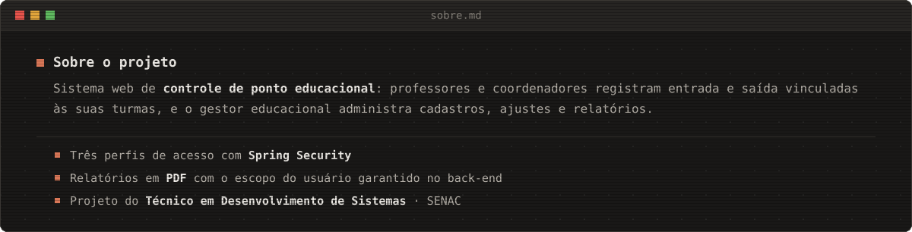
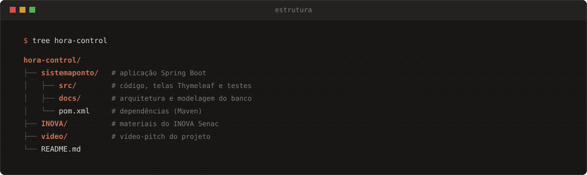

1. Crie no PostgreSQL o banco `sistemaPonto`.
2. Em [`sistemaponto/`](sistemaponto), copie `.env.example.properties` para `.env.properties` e configure a conexão e a senha inicial do gestor.
3. Suba a aplicação e acesse `http://localhost:8080`:

```bash
cd sistemaponto
./mvnw spring-boot:run        # no Windows: .\mvnw.cmd spring-boot:run
```

Para rodar os testes (JUnit + Spring Security Test, com H2 em memória):

```bash
./mvnw clean test
```



| Documento | O que tem |
| --- | --- |
| [README técnico](sistemaponto/README.md) | Perfis e permissões, regras de negócio, banco e migrações |
| [Arquitetura atual](sistemaponto/docs/ARQUITETURA_ATUAL.md) | Como o código está organizado |
| [Modelagem do banco](sistemaponto/docs/MODELAGEM_BANCO_DADOS.md) | Tabelas e relacionamentos |

<a href="https://github.com/GabrielCardossso"></a>
